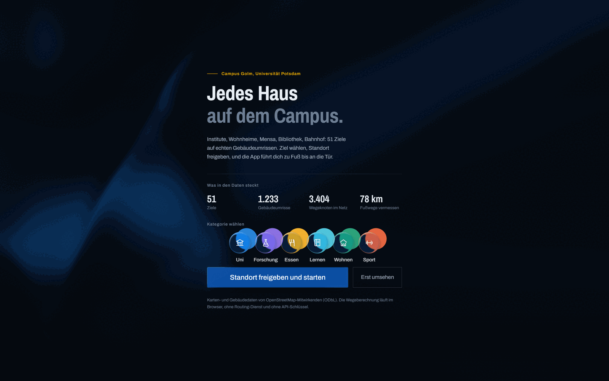
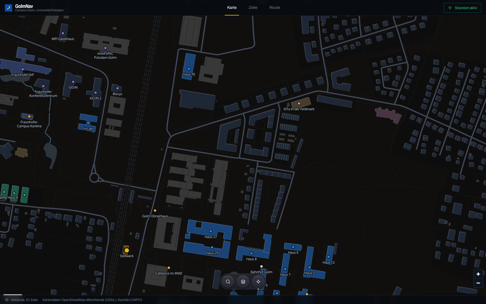
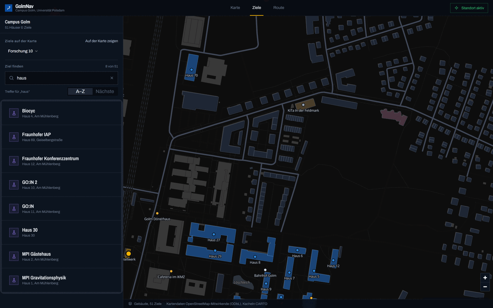
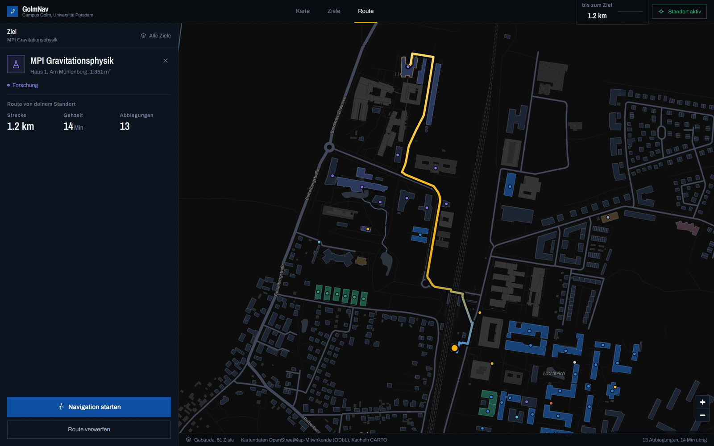
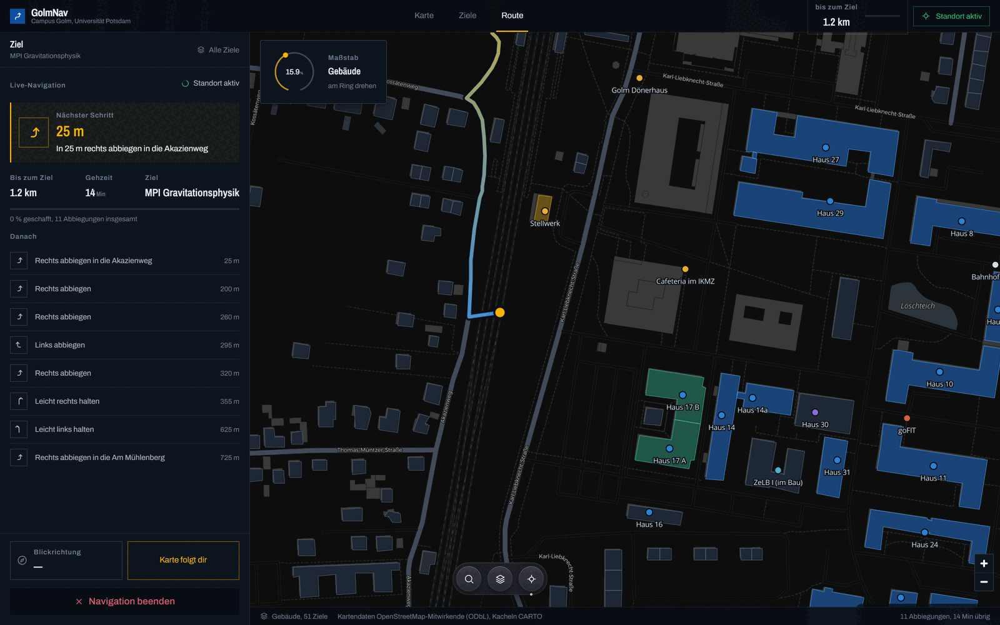
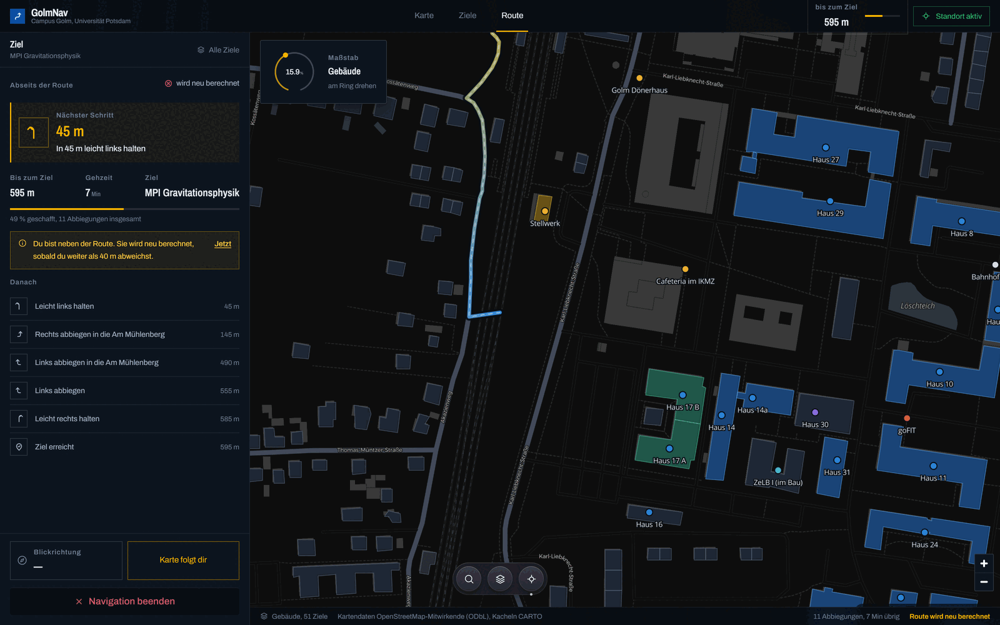
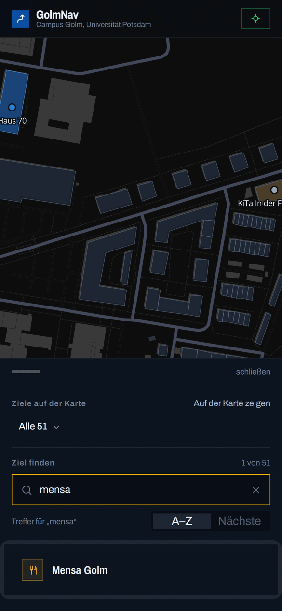

# GolmNav – Campus Golm Navigator

Navigationssystem für den **Campus Golm der Universität Potsdam**. Alle Häuser liegen auf
einer Karte, du wählst ein Ziel und bekommst mit deinen Live-Standortdaten den Weg dorthin –
inklusive Blickrichtung, automatischer Neuberechnung und Schritt-für-Schritt-Hinweisen.

**React + Vite + TypeScript + Tailwind, Karte mit MapLibre GL, Routing vollständig im Browser.**



## Was es macht

### Alle Ziele auf einer Karte

51 ausgewählte Ziele – Haus 1–70, BaseCamp 1–6, H-Labor, GO:IN, Mensa, Stellwerk,
Fraunhofer, Max-Planck-Campus, Bahnhof Golm – liegen auf 1 233 echten Gebäudeumrissen aus
OpenStreetMap. Jedes Ziel ist anklickbar und wird mit Namen und Hausnummer beschriftet.



### Ziel finden und Route bekommen

Die Volltextsuche greift über Name, Hausnummer, Straße und Kategorie. Darunter filtern
Schaltflächen nach Universität, Forschung, Essen, Lernen, Wohnen, Sport, Service und Verkehr,
und die Trefferliste lässt sich alphabetisch oder nach Entfernung sortieren.



Nach der Zielwahl steht die Route: Distanz, Gehzeit, Ankunftszeit und die Anzahl der
Abbiegungen. Der Weg folgt dem echten Fußwegenetz aus OSM, nicht der Luftlinie.



### Live-Navigation unterwegs

GPS-Position, Kompass-Blickrichtung, Fortschrittsbalken und Schritt-für-Schritt-Hinweise.
Der Standort kommt vom Gerät, verlässt es nicht.



Weichst du mehr als 40 m von der Route ab, rechnet die App im Hintergrund neu – ohne dass
du die Navigation anhalten musst.



### Auf dem Handy

Dieselbe App, dieselbe Zielliste, für 390 px Breite.



## Was drinsteckt

- **Eigenes Routing.** Ein Fußweg-Graph aus OpenStreetMap (3 404 Knoten, 3 832 Kanten) wird
  mit A\* und einer Luftlinien-Heuristik im Browser durchgerechnet. Keine Anfragen an einen
  Routing-Dienst, kein API-Key, funktioniert offline, Antwortzeit unter einer Millisekunde.
  Alle 51 Ziele liefern dieselbe Distanz wie eine Dijkstra-Referenzimplementierung.
- **Startpunkt per Klick.** Ohne Standortfreigabe tippst du einfach auf die Karte – die
  Route wird trotzdem berechnet.
- **Karte ohne Schlüssel.** MapLibre GL mit CARTO-Kacheln, dazu ein eigener Style-Layer für
  Gebäude nach Kategorie, Route, Fortschritt und Marker.
- **15 Komponenten von [React Bits](https://reactbits.dev).** Jede hat eine Aufgabe:
  Karten-Dock, Ring für den Maßstab, Halteknopf zum Beenden, Liste, Auswahl, Einstieg.
  Welche das sind und warum andere wieder ausgebaut wurden, steht in
  [`docs/architecture.md`](docs/architecture.md).

## Starten

```bash
npm install
npm run dev      # Entwicklung: http://localhost:5173
npm run build    # Produktionsbuild in dist/
npm run serve    # gebauten Stand ausliefern (Port 4180)
```

### Auf dem Handy testen

Der Browser gibt den Standort nur in einem sicheren Kontext frei – `http://<IP>:4180`
reicht **nicht**, auch nicht über Tailscale. Deshalb geht der Weg über HTTPS:

```bash
npm run build
npm run serve                                          # lauscht auf 127.0.0.1:4180
tailscale serve --bg --https=8443 http://127.0.0.1:4180
# -> https://<host>.<tailnet>.ts.net:8443
```

Denselben Zweck erfüllt ein Tunnel (zum Beispiel `ngrok http 4180`), der eine
`https://`-Adresse liefert. Port 4180 statt 5173, damit nichts mit anderen Projekten
kollidiert.

## Woher die Daten kommen

Alle Karten- und Gebäudedaten stammen aus **OpenStreetMap (ODbL)**. Die Kacheln liefert
**CARTO** (dark matter, kostenlos, ohne Account).

```
scripts/
  fetch_osm.mjs      Rohdaten für Campus Golm herunterladen (scripts/data/tile-*.xml)
  build_campus.mjs   Fußweg-Graph + Gebäudeumrisse  ->  src/data/campus.json
  dump_places.mjs    benannte POIs aus den Rohdaten  ->  out/pois_raw.json
  build_pois.mjs     kuratierte Zielliste            ->  src/data/pois.json
  fetch_bits.mjs     React-Bits-Komponenten aus der Registry holen -> scripts/data/
  extract_bits.mjs   Komponentenliste -> src/bits/ (+ MANIFEST.json)
```

```bash
npm run data:fetch   # nur nötig, wenn die OSM-Rohdaten neu gezogen werden sollen
npm run data:build   # baut campus.json und pois.json aus scripts/data/
```

`build_campus.mjs` behält nur die große zusammenhängende Wegekomponente, verbindet
Kreuzungspunkte über ihre Koordinaten und zeichnet die Umrisse mit Douglas-Peucker nach,
damit die Datei klein bleibt. Neue Ziele trägst du in `build_pois.mjs` in `EXTRAS` bzw.
`OVERRIDES` ein und lässt `npm run data:build` erneut laufen.

`scripts/data/` ist ausdrücklich nicht versioniert: die OSM-Rohdaten (10 MB) und die
React-Bits-Registrydateien (9 MB) lassen sich mit `npm run data:fetch` und
`npm run data:bits:fetch` jederzeit neu holen.

## Aufbau

```
src/
  App.tsx                    Zustand, Suche, Route, Navigationsmodus
  components/MapView.tsx     MapLibre-Karte, Kamera, Klick-Handling
  components/panels.tsx      Zielliste, Ziel-Detail, Live-Navigation
  components/ui.tsx          Icons und Kategorie-Marker
  hooks/useLiveLocation.ts   GPS, Kompass, Permission-Handling
  lib/geo.ts                 Distanz, Peilung, Formatierung
  lib/graph.ts               Routing-Graph + A* mit Binärheap
  lib/routing.ts             Route, Abbiegehinweise, Abweichungserkennung
  lib/mapLayers.ts           Style-Layer für Gebäude, Route, Marker
  bits/                      React-Bits-Komponenten (15 im Einsatz, Liste im MANIFEST)
  data/                      campus.json und pois.json
```

Die Komponenten in `src/bits/` sind 1:1 aus der [React Bits](https://reactbits.dev)-Registry
(TS+Tailwind-Variante) übernommen; `scripts/extract_bits.mjs` spielt sie reproducibly wieder
ein und schreibt die Auswahl nach `src/bits/MANIFEST.json`.

Wie die Oberfläche aufgebaut ist, welche Farbe was bedeutet und welche Komponenten
ausprobiert und wieder ausgebaut wurden: [`docs/architecture.md`](docs/architecture.md).

Die Screenshots im README entstehen mit `node docs/capture.mjs`; Details stehen in
`docs/screens/README.md`.

## Bedienung

| Aktion | Desktop | Mobil |
| --- | --- | --- |
| Suche fokussieren | `/` | Suchfeld antippen |
| Auswahl aufheben | `Esc` | × im Panel |
| Standort freigeben | `L` | Schaltfläche oben rechts |
| Startpunkt setzen | auf die Karte klicken | auf die Karte tippen |

Die Standortfreigabe ist optional. Ohne sie zeigt die App weiter alle Häuser und du kannst
einen Startpunkt auf der Karte setzen. Der Standort verlässt das Gerät nicht – es gibt keinen
Server, an den etwas gesendet wird.

## Hinweis zu den Daten

Die Hausnummern und Zuordnungen stammen aus OpenStreetMap und sind nicht die amtliche
Campus-Nummerierung. Für die Orientierung auf dem Campus reicht es, für Aushänge oder
offizielle Wegbeschreibungen bitte gegen den Campusplan der Universität prüfen.
